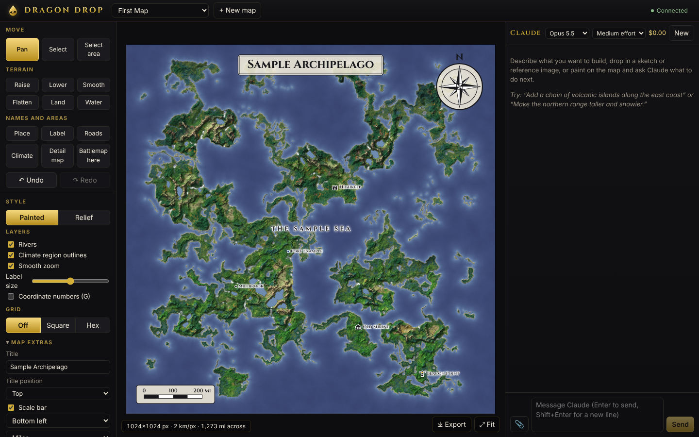
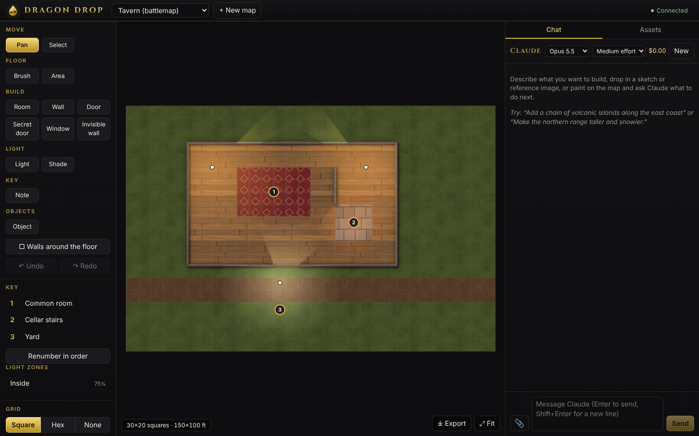

# Dragon Drop

**Dragon Drop** is a map editor you build maps in by talking with Claude. It is a Windows program (installer: [docs/SETUP-WINDOWS.md](docs/SETUP-WINDOWS.md) §0); you can also run it from the code. Paint and sculpt by hand, or ask Claude; both of you edit the same map, with shared undo and a history of who did what. Attach sketches or reference images and Claude works from them.



**What it makes**

- **World and regional maps**: terrain you sculpt or generate, Painted Relief and plain relief styles, rivers and lakes from the terrain, a climate model, erosion, named places, curved labels, roads, borders, climate regions, map furniture, a hex or square grid, and a detailed regional map of any area. A view-only **phone page** (`/view`, private over Tailscale) follows your edits live.
- **Battlemaps**: floors, rooms (round, polygon or cave-shaped, with walls traced automatically), thick stone walls with soft shadows, wooden doors, windows, secret doors, objects, and lights with **line-of-sight shadows**, a **light level** (bright, dawn, dusk, dim, night, dark) with shaded areas such as a dim indoors, and a numbered **key** of room notes. Make one from a spot on a world map, bring in your own **assets** (folders of pictures, zip files or asset packs; read in place, never copied), and export a Universal VTT file or a Foundry scene.
- **Claude Code inside the app**: the right-hand panel is a terminal running Claude Code with the map tools already connected (your Claude subscription, no API key needed). In a browser, the same panel is a chat that uses an API key.



**Status:** the installer, in-app updates, the embedded Claude Code terminal, world and regional maps and the battlemap editor all work and are tested automatically on Windows. Not yet checked by a person on a real PC: Foundry / Universal VTT imports, real asset packs, the update flow.

## Run it from the code (Windows)

The installer is the easier route (see §0 of the [setup guide](docs/SETUP-WINDOWS.md)). To run from a checkout instead:

```powershell
git clone https://github.com/DJ-JackJack/dragon-drop.git
cd dragon-drop
pnpm install
copy .env.example .env     # then add your ANTHROPIC_API_KEY for the in-app chat
pnpm start                 # opens http://localhost:4747
```

The full guide covers prerequisites, the editor, Remote Control and the map page on your phone, and troubleshooting: **[docs/SETUP-WINDOWS.md](docs/SETUP-WINDOWS.md)**.

## Two ways to talk to Claude

| | In-app chat (browser mode) | Claude Code (in the app, or Remote Control) |
|---|---|---|
| Where | Chat panel next to the map | The terminal panel in the app, a terminal on your PC, or the Claude app on your phone |
| Billing | Claude API key, pay per use (cost shown live) | Your Claude subscription |
| Images | **Add picture** in the References panel, or drop or paste a picture anywhere in the window (in the chat, it goes with your message) | The same: Claude finds it with its reference tools, and **Ask Claude…** on a picture points Claude Code at it |
| Tools | Same map tools | Same map tools (via `.mcp.json`) |

## Docs

- [docs/PLAN.md](docs/PLAN.md): architecture, Claude's tool set, roadmap
- [docs/RESEARCH.md](docs/RESEARCH.md): research and sources behind the plan
- [docs/CONTROLS.md](docs/CONTROLS.md): keyboard and mouse controls, and how they compare with other map programs
- [docs/FORMATS.md](docs/FORMATS.md): the file types Dragon Drop reads and writes, and what doesn't work
- [docs/MAP-FILES.md](docs/MAP-FILES.md): what is in a map folder, how maps are kept safe (versioned files, automatic backups) and how to back one up
