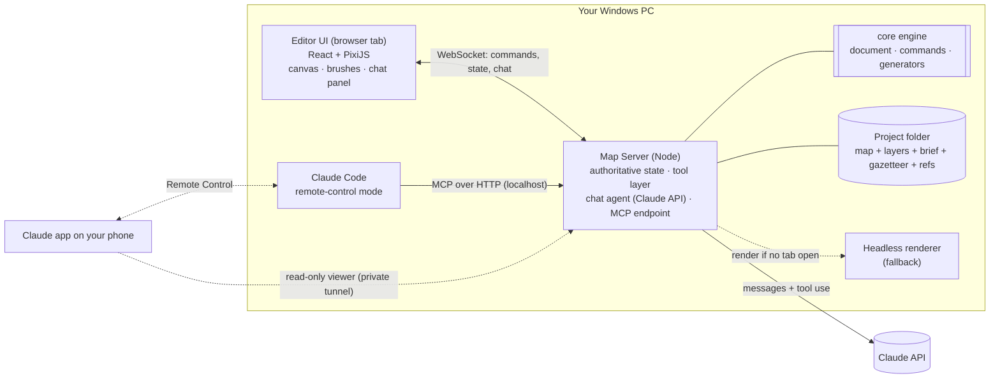

# Build Plan: Dragon Drop (formerly "AI Mapmaker")

*Draft 2, 2026-11-15. Background and sources are in [RESEARCH.md](RESEARCH.md).*

## 0. Decisions so far

| Topic | Decision |
|---|---|
| Where we talk | **Chat built into the app** (Claude API) as the main way in. **Claude Remote Control** for building on the go: Claude Code running on your PC, driven from your phone. |
| First mode | **World maps first.** Proof of concept: a first archipelago world, designed together from scratch (the DM's own setting; its maps and notes are kept on the DM's machine and are not part of this repository). |
| Platform | **Windows.** The editor runs in a browser tab for now. |
| Assets | Your own **asset library** (folders of pictures, zip files and asset packs; more bought as needed). Personal use unless a pack's licence says otherwise. |
| VTT | **Foundry VTT v14** |
| Target look | **Reference #2 ("Painted Relief")**: painted biome colours, shaded relief, snowy ridges, pale coastal shelf, serif labels. See [§7](#7-target-style-painted-relief). |

---

## 1. The idea

A map editor that both of us work in. You can paint, sculpt and drag things by hand. I work in the same document through a tool API: I read reference images, plan, build, look at renders, compare and refine while we talk. Claude can't generate pixels, so the map is a **structured document** (heightmap, climate, rivers, coastlines, labels, and later walls, props and lights), and a renderer turns it into art. Every map therefore stays editable and can be regenerated, and battlemaps export real VTT walls, doors and lights.

Two modes, one engine:

| | **World / regional maps** (first) | **Battlemaps** (later) |
|---|---|---|
| Core data | Heightmap, climate and biome fields, rivers, lakes, coastlines, labels, gazetteer | Ground materials, elevation, walls, doors, props, lights |
| Look | Painted Relief first, more styles later | Textured top-down, shadows and lighting |
| Exports | Large PNG/WebP (tiled), layered PSD later | PNG/WebP, Foundry v14 scene, Universal VTT |

The two modes link: you'll be able to pick a spot on a world map and make a battlemap there, and it inherits that spot's biome, elevation, coast or river, and climate.

---

## 2. How sessions will feel

**At your desk (in-app chat):**
> **You:** "Let's start a new world. A cluster of five or six big islands and lots of small ones, temperate in the north, warm in the south. The biggest island is the heartland, where the capital sits on a sheltered bay."
>
> **Claude:** writes the brief to the project, then generates 3 candidate layouts (`generate_terrain` × 3 seeds) and shows them side by side.
>
> **You:** "B, but the western island should curl around like a hook, and put a volcanic chain down the east side."
>
> **Claude:** `reshape_landmass` (hook), `add_feature(volcanic_chain, path)`, `erode`, `compute_hydrology`, `render_preview`. "Here's B with the hook. The volcanic spine puts the east coast in rain shadow, so it's come out dry steppe. Keep that, or move the spine?"
>
> **You:** *(paints the bay a little wider with the coast brush)* "Keep it. Name the bay."

**On the go (Remote Control from your phone):**
> On your PC, `claude remote-control` is running in the mapmaker folder and the map server is up. On your phone, in the Claude app: "Add a chain of reef islands south of the heartland and label the strait between them." Claude Code uses the same map tools. You see previews in the chat and can open a read-only viewer page on your phone (§3). When you're back at your desk, the in-app chat picks up the same project and brief.

---

## 3. Architecture



1. **The server owns the document.** Your brushes and my tool calls are the *same* command objects: serialisable, undoable, and tagged with who made them. That gives shared undo, named checkpoints, and `get_changes_since` so I can see what you changed by hand.
2. **The in-app chat agent runs on the server.** It uses the Anthropic TypeScript SDK's tool runner with our tool set. Your **API key stays on the server** in a local `.env` file and never reaches the browser. Images you drop into the chat go straight to Claude *and* into the Reference Tray. The chat panel shows a **cost meter**. The default model is Claude Opus 5.5, with Sonnet 5.5 as a cheaper switch. Prompt caching and downscaled previews keep costs down (rough estimate: $1–5 per heavy session).
3. **The same tools over MCP** at `http://localhost:<port>/mcp`. The repo's `.mcp.json` registers it, so any Claude Code session in the project folder has the map tools. That includes a Remote Control session you drive from your phone, which runs on your Claude subscription rather than the API.
4. **Shared memory across both ways in.** Each project keeps a `brief.md` (decisions so far) and a `gazetteer.json` (named places with coordinates and notes). Both Claudes read and update them through tools, so a phone session and a desk session don't lose context.
5. **One renderer, used everywhere.** The PixiJS renderer serves the editor, previews and exports. A headless Chromium copy covers previews when no tab is open (for example on the go).
6. **Phone viewing.** A read-only `/view` page served by the map server, reachable privately from your phone through Tailscale or a similar tunnel. Previews also appear in the chat itself.

**Stack:** TypeScript · pnpm monorepo · Vite + React · PixiJS v8 · Zod · Anthropic TS SDK · MCP TS SDK · Hono · Clipper2 · Vitest + Playwright. The desktop app is Electron (not Tauri: the server is Node), see M2b below.

```
packages/core       document model, commands/undo, generators (noise, erosion, hydrology, climate), geometry
packages/renderer   PixiJS layer renderers + styles (painted-relief first), tiled export
packages/tools      tool definitions (zod) + handlers — shared by the chat agent and MCP
packages/exporters  png/webp/psd, foundry v14, uvtt
packages/ddpack     asset pack reader (for battlemaps, M3)
apps/server         state, ws sync, chat agent, MCP endpoint, asset index, headless render, /view
apps/editor         React UI: canvas, brushes, layers, chat panel, reference tray, history
skills/mapmaking    instructions both Claudes load: cartography + battlemap conventions, tool recipes
```

---

## 4. The map document

```ts
MapDocument {
  id, name, kind: "world" | "battlemap", seed,
  size:  { width, height, kmPerPx } | { cols, rows, pxPerCell },
  grid:  { type: "none" | "hex" | "square", visible },
  style: StyleId + overrides,
  layers: Layer[],
  references: Reference[],
  brief: "brief.md", gazetteer: Place[],   // shared design memory
  link?: { worldMapId, x, y }              // battlemap ↔ world
}

World layers:  Height (Float32) · Climate (temperature, moisture: generated + painted overrides)
               · Climate regions (named overrides of the natural gradient; optional owner, e.g. a spirit)
               · Biome overrides (painted masks) · Hydrology (rivers/lakes, derived + edited)
               · Vector (coasts, roads, borders, regions) · Labels · Markers (cities, POIs; optional in this style)
Battle layers: Material splats · Water · Walls/Portals · Objects · Lights · Effects
```

- **Derived vs. authored:** rivers, coasts and biomes are *derived* from height and climate, so they update when you reshape land. Anything you paint or edit by hand is stored as an *override* and survives regeneration.
- **Storage:** plain project folders on disk (`map.json`, 16-bit PNG heightmap, PNG masks, `brief.md`, `gazetteer.json`, `refs/`). Easy to back up or keep in git.

---

## 5. Claude's tools (world-map focus first)

**Look:** `get_map_summary` · `get_changes_since` · `query_point/region` (elevation, biome, climate, nearest river or coast) · `render_preview(region?, overlays: coords|labels|biomes|rivers)` · `compare(a, b)` side by side · `view_reference(id, crop?)` · `analyze_reference(id, regions|lines|heightmap)`

**Brief and gazetteer:** `get_brief` · `update_brief` · `add_place(name, type, at, notes)` · `list_places` · `export_gazetteer(markdown)`, which can feed your campaign encyclopedia.

**Shape the land:**
- `generate_terrain(template, params, seed)`
- `add_landmass(shape, size, at)`
- `reshape_landmass(id, …)`: grow, shrink, curl, split, join
- `sculpt(op, shape, strength)`
- `add_feature(mountain_range | volcanic_chain | rift | plateau | reef | fjords, path, params)`
- `set_sea_level`
- `mask_from_reference`

**Make it physical:** `erode(strength)` · `compute_hydrology(river_threshold)` · `compute_climate(lat_range, prevailing_wind)` · `paint_biome(biome, shape)` (override)

**Climate regions** *(built in M1 part 5; see the progress note)*: `add_climate_region(name, region, {temperature, moisture, snow}, border: hard|soft, owner?)` · `edit_climate_region` · `remove_climate_region`. A named area whose climate replaces the natural gradient inside its borders, for things like spirit domains, cursed lands or eternal winters. There's a prototype in `render_textured.py` (`overrides`).

**Cartography:** `add_label(text, at|along, tier)` · `auto_place_labels` · `set_style(theme, overrides)` · `add_marker(type, at)`

**History and output:** `checkpoint` · `undo` · `revert_to` · `export(png|psd|…, size)`

The battlemap tools from draft 1 (layout spec, walls, assets, scatter, lights) arrive in M3.

---

## 6. From reference image to map

| Reference | Pipeline |
|---|---|
| **Your sketch of island shapes** (paper photo or quick digital doodle) | `analyze_reference(regions)` → we confirm "dark = land" → land mask → heightmap seeded from distance to coast + ridges along drawn mountain strokes + noise → erode → hydrology → climate → render → compare with the sketch → adjust. |
| **A map you like the shape of** | The same, plus `lines` extraction for coasts. Used as inspiration, then reshaped by talking. |
| **Mood or concept art** | Read for meaning, not traced: palette, terrain character ("jagged volcanic", "misty fjords") and climate cues drive the parameters. |
| **Greyscale heightmap / real elevation data** | Imported directly as the Height layer. |

Every pipeline ends in a **render → compare → adjust** loop.

---

## 7. Target style: Painted Relief

Analysed from your reference #2 and confirmed achievable by an early prototype (since replaced by the painter itself, `packages/core/src/painted.ts`):

| Element | In the reference | How we render it |
|---|---|---|
| Deep ocean | Muted slate/navy, faint lighter wisps | Depth-based colour plus low-frequency noise wisps |
| Shelf | Wide pale steel-blue glow along coasts, lighter in enclosed seas | Distance-to-coast falloff blended with bathymetry |
| Coastline | No ink outline, soft transition | No stroke. The shelf glow does the work. |
| Lowlands | Olive and grass greens, deep forest/jungle greens, pale sand deserts with soft painted edges | Temperature × moisture palette over blurred climate fields. Painted biome overrides for deliberate deserts and jungles. |
| Highlands | Tan, peach and brown flanks | Rock blend by elevation and slope |
| Mountains | Dense fine relief, white snow on ridges, blue-grey shadows | GPU hydraulic erosion, then multi-directional hillshade, then ridge-weighted snow with cool shadows |
| Rivers and lakes | Thin grey-blue meandering lines widening downstream. Lighter-blue lakes. | Hydrology, smoothed polylines, width by flow |
| Polar ice | Puffy cloud-like bands | Optional (a regional archipelago map may not reach the poles) |
| Labels | Large letter-spaced serif caps, black with a soft white glow, curved along seas. Smaller caps for gulfs and bays. | Label engine: Cinzel-style font, glow, curved paths, size by importance |
| Extras | No grid, frame, icons or borders | Off by default, can be switched on later |

The prototype's gaps (softer mountain detail, step-like rivers, straight labels) are listed in its README. They're the M1 and M2 work.

---

## 8. Assets (for battlemaps, M3)

- **Asset packs:** several map tools keep their art in a Godot PCK archive (`GDPC` signature, file table with offsets), a layout the Godot engine documents openly. Inside are PNGs under `textures/` (objects, terrain, walls, paths, portals, lights…) and tag data in a `data/` folder. Assets are usually authored at **256 px per grid square**. Our reader opens such packs directly (recognising them by their first bytes, not their name), keeps their folders and tags as search tags, and caches thumbnails. The library also takes plain folders of pictures and `.zip` files (the folder names, such as Floors or Props, say what is inside). Licensing is up to each pack's author: we read the user's own copies in place and never ship any, and a pack's own flag saying it may not be used in other programs is honoured.
- **Starter content:** CC0 textures and procedural materials, so the app works before any pack is imported.
- **Claude-assisted tagging:** I view thumbnail contact sheets and add descriptive tags, so "mossy broken pillar" finds the right asset.

---

## 9. Roadmap (reordered for world maps first)

Each milestone ends with something you can try. Sizes are relative.

### M0: Foundations + both ways to talk *(small–medium)*
- Monorepo, core document and commands, server, editor canvas (pan, zoom, layers panel).
- Tool layer with the first tools: `create_map`, `generate_terrain` (basic), `sculpt`, `render_preview`, `get_map_summary`, `undo`, `get_brief` / `update_brief`.
- **In-app chat panel** (Claude API, image upload, cost meter) and **MCP endpoint** with `.mcp.json`. A Windows setup guide, including API key setup and starting Remote Control.
- **Exit:** at your desk, "make an ocean map with a round island in the middle, then raise a mountain on its west side" works in the app's chat. The same request works from your phone through Remote Control.

> **Status (2026-11-15): built.** In the repo and tested in the cloud dev environment:
> - **Tests:** 23 unit and integration tests, plus a browser smoke test covering load, brush, undo and a full scripted chat turn with tool chips and preview images.
> - **MCP:** verified with a real MCP client against the live server.
> - **Tools shipped:** `get_map_summary`, `render_preview` (grid, crops, markers), `query_points`, `create_map`, `list_projects`, `open_project`, `generate_terrain`, `add_landmass`, `add_mountain_range`, `sculpt` (raise, lower, smooth, flatten, set, roughen), `set_sea_level`, `undo`, `redo`, `get_changes_since`, `get_brief`, `update_brief`, `list_references`, `view_reference`.
> - **First project:** a new install opens on a generated map (the DM's own world map is kept locally, never shipped).
>
> **Still to verify on the DM's PC:** a real Claude API conversation (needs the API key), and Remote Control from the phone.
>
> **Deliberate deviations:**
> - The M0 map view uses a CPU renderer on a 2D canvas, shared with the server's previews. PixiJS and shaders arrive with the Painted Relief renderer in M1.
> - No Claude Desktop `.mcpb` shim yet; it isn't needed for the in-app + Remote Control setup.
> - The phone view-only page arrived in M1 part 2.

### M1: World terrain engine *(large)*
- Height layer with brushes (raise, lower, smooth, flatten, coast push/pull), landmass and feature tools, terrain templates.
- GPU hydraulic erosion, hydrology (rivers, lakes, pit-filling), climate and biomes with painted overrides.
- **Painted Relief renderer:** the prototype's passes ported to shaders, at full quality.
- Checkpoints, history, `get_changes_since`, side-by-side compare.
- **Exit:** we can sketch, generate and reshape an archipelago by talking and brushing, and it looks at least as good as the prototype.

> **Progress (2026-11-15), part 1 done:**
> - **Painted Relief renderer:** a TypeScript port of the prototype. It matches pass 6 and redraws brush-sized tiles in about 7 ms.
> - **Climate model:** latitude and altitude temperature, plus moisture from coasts, rain shadow and latitude, with settings the DM confirms per map.
> - **Hydrology:** rivers and lakes, recomputed by the server about 0.7 s after edits settle and pushed to the editor.
> - **Erosion command:** stream-power erosion with smoothing.
> - **Checkpoints:** named saves; restoring one is itself undoable.
> - **New tools:** `erode`, `set_style`, `set_climate`, `save_checkpoint` / `list_checkpoints` / `restore_checkpoint`, `compare_to_reference`.
> - **Editor:** Painted/Relief switch, Rivers layer, checkpoints panel. The noise is built in a Web Worker and full repaints run in slices.
>
> **Part 2 done (2026-11-15):**
> - **Places and labels:** a gazetteer of named places (type, notes, hidden-name option) and map labels (sea, region, range, island, feature) with angle, curve and size. Labels use Cinzel caps with a soft white glow. Both are undoable and shared with Claude. The tools are `add_place` / `update_place` / `remove_place` / `list_places`, `add_label` / `update_label` / `remove_label` / `list_labels` and `export_gazetteer`, and `render_preview` can show labels. *(Brought forward from M2.)*
> - **Editor:** Select, Place and Label tools, drag-to-move, an inspector for the selection, and a Places list. **Land** and **Water** coast brushes. A **Climate** panel. **PNG export** at 2× with rivers and labels.
> - **Phone page:** read-only `/view` that follows edits live, with pinch-zoom and tap-a-place notes, reached privately through Tailscale (setup guide §7). `GET /api/projects/:id/render.jpg` serves the server's render. *(Brought forward from M2.)*
>
> **Part 3 done (2026-11-15): sharper detail.**
> - **2048 px maps** (the DM's world was upscaled to 3.9 km per px). New `pnpm upscale <project>` doubles any map's resolution: bicubic upsampling, fractal wiggle on low coasts (balanced so land area is kept; cliffs untouched), ridged detail on high ground, then erosion.
> - **Speed at 2048:**
>   - Large blurs are now three running box blurs: a full repaint takes 1 s instead of 5 s, and a brush redraw 11 ms instead of 57 ms.
>   - Rain shadow is computed at half resolution on big maps.
>   - The climate step only builds the noise it needs.
> - **Heavy work off the main thread:** the server runs climate/rivers and painting on two worker threads, so editors, chat and MCP never stall. The editor builds its texture noise in parallel bands across several web workers.
> - **Phone viewer:** connects in "lite" mode (no heightmap or climate frames; 36 MB saved at 2048) and reloads the render when the server says the map changed.
>
> **Part 4 done (2026-11-15): labels along lines and automatic name placement.** *(From M2.)*
> - Labels can follow a line (`path`): drag with the Label tool, or Claude passes points to `add_label`. Text is centred on the line, reads left to right, and can **spread** along its whole length (the default for range names). Moving the label moves the line; "Straighten" turns it back into a plain label.
> - Place names choose the first free side of their marker (right, left, above, below, then the diagonals), avoiding labels, markers and each other; bigger places choose first. Each place can also be pinned to a side.
>
> **Part 5 done (2026-11-15): the Climate regions tool.** *(From M4.)*
> - A climate region is a named outline whose temperature, moisture and/or ground snow override the natural gradient, with strength, a hard or soft border (blend width in km), an optional owner and notes. It's applied in the climate step, so vegetation, colours and snow all follow, and it recomputes about a second after any change. Every change can be undone.
> - **Editor:** Region tool (C): click corners, then double-click, click the first corner or press Enter to close. Select drags a region, Delete removes it. The inspector has override checkboxes and sliders. A "Climate regions" list and an outline layer sit in the sidebar.
> - **Tools:** `add_climate_region`, `update_climate_region` (null stops an override), `remove_climate_region`, `list_climate_regions`; previews show the outlines.
> - **Jungle and desert (2026-11-16):** the painted style gives hot, very wet land (temperature 0.9+, moisture 0.9+) its own look instead of a darker green: a dense, lumpy canopy in groves with dark gaps, laid out in stands of different age and kind (dark blue-green old growth, lighter green regrowth, the odd clearing), and it covers most of the rock texture on gentle low ground (steep faces and high ridges keep their rock and snow). Hot, arid land (moisture 0.05 or less) gets sand: pale, ochre and rust patches, dune ridges that run across the prevailing wind (so they follow `set_climate` wind), steep darker lee sides, fine ripples and sparse scrub on the flats between dunes. Natural gradients stay below both thresholds (`jungleWeight`/`desertWeight` in `painted.ts`), so only regions and equatorial maps show them.
>
> **Part 6 done (2026-11-15): regional maps.** *(New.)*
> - **Detail map** tool (D): drag a box on any map and get a separate, more detailed map of that area (2× to 16× finer, up to 2048 px), opened straight away. Terrain is the parent's, upscaled in steps with new detail and erosion at each scale; the parent's temperature, moisture, ground snow and lakes carry over (so rain shadows and climate regions from beyond the box still apply, and a hollow the parent doesn't show as a lake isn't invented as one); places and labels inside the box are copied.
> - The two maps are separate afterwards. Each remembers its link (`meta.parent`): the sidebar lists a map's children and jumps between them, the parent outlines its children, and Claude's `get_brief` on a regional map includes the parent's brief (canon stays with the parent). The `create_regional_map` tool does the same for Claude. "Update from parent" re-reads the climate.
> - The painter shades zoomed maps at the parent's scale as well as the pixel scale, so a regional map looks like a closer view of its parent and not a blurred one.
>
> **Part 7 done (2026-11-15): grid overlay and in-app dialogs.**
> - **Grid:** square or hex, any cell size in miles, hex orientation and line strength. Stored in the map (`meta.grid`), so it's undoable, saved, shared with Claude (`set_grid`) and drawn in the editor, the phone viewer and PNG exports. Changing it doesn't recompute the climate.
> - Browser pop-up boxes (`prompt` / `confirm`) are replaced by the app's own dialogs: browsers can block or hide the pop-ups, which made the Place tool look like it did nothing. Each tool now shows a hint, and the Climate and Detail map tools have a visible cursor.
>
> **Part 8 done (2026-11-16): roads and borders.** *(Cartography.)*
> - **Roads tool** (O) in the editor and Claude's `route_road` / `add_line` tools: roads and trails are found over the terrain (A* on a coarse grid: flat ground cheap, steep slopes costly, sea and lakes blocked, river crossings costly, existing roads preferred) from two or more clicks; borders are drawn exactly and can be closed. Lengths are reported in miles and days on foot (24 mi a day).
> - Lines are selectable, movable, renameable and undoable, drawn in the editor, the phone viewer, PNG exports and Claude's previews, and clipped into detail maps.
>
> **Part 9 done (2026-11-16): map extras and large exports.** *(From M2.)*
> - **Map extras** (`meta.furniture`, undoable, `set_map_furniture` for Claude): title banner, scale bar (tidy 1/2/5 lengths, miles or km), compass rose, frame; drawn in the editor, the phone viewer and exports.
> - **Export dialog:** 1×, 2×, 4× and 8× with checkboxes for rivers, places/labels/roads, grid and extras. Up to 8192 px is one PNG; above that it's 4096-px tiles in a `.zip` (own minimal ZIP writer, checked against Python's reader). Every tile samples the same scaled bitmap, so joins are seamless; a full 16384 px export of a 2048 map takes about 12 s.
>
> **Part 10 done (2026-11-16): sketch to terrain.** *(From M2's reference tray.)*
> - Turn a drawing into terrain: the sea is the background colour found at the image's edges; pixels nearer to the sea colour than to the typical land colours count as sea (hue-aware, so pale coast halos and lighter inner seas stay water); red strokes become mountain ranges; "enclosed" background areas become water or land depending on whether the drawing is filled or only outlined. The land gets an inland rise, rolling hills, ragged coasts (which back off on thin strips so narrow ring islands survive), ranges with ridged detail, a continental shelf and deep sea, then light erosion.
> - Editor: **Make terrain…** under each reference opens a dialog with a live classification preview. Claude: `import_sketch` (asks before replacing an existing map; saves a checkpoint). Run on the DM's own sketch it reproduced its ring formation, the islet scatter and the ranges along the red lines in about 1.7 s at 1024 px.
>
> **Still to do in M1:** GPU erosion at higher resolution.

> **Suggest, Assist and smooth zoom (2026-11-16).** A **Suggest** button and an **Assist** switch above the Claude Code terminal: Claude looks at what the DM changed and gives up to three ideas, suggest-only, through the DM's Claude Code subscription (no API spend). Rules are pure and tested (`packages/core/src/assist.ts`): Claude Code's hooks (installed by the desktop app into its workspace `.claude/settings.json`, calling `POST /api/claude-hook` with `curl`) report idle / working / waiting, and nothing is ever typed unless Claude Code said it is idle, the terminal is quiet and does not look busy, and the DM is neither editing nor typing. A **Smooth zoom** view option blends terrain pixels instead of hard blocks.
>
> **Speed review (2026-11-16).** Measured on a 2048 map (browser: load and edit stalls with long-task timing and a CPU profile of an unminified build; server: Node CPU profiles). Pan and zoom were already a steady 60 fps. Fixed: (1) every save held the server's event loop for about 500 ms (synchronous gzip of the 17 MB map): saves, checkpoints and loads now use the async versions, and a save takes its snapshot before its first await so an edit made while it compresses can't be written half-and-half (this also fixed a latent race); (2) after every edit the whole map was repainted when the recalculated climate arrived (about 15 main-thread stalls, 1.6 s in total): the editor now repaints only the box around the cells that changed (`derivedChange`), and skips the repaint when nothing a pixel depends on changed; a large change is still repainted in slices; (3) at load a full-size relief render (about 1 s) was shown for a moment and then painted over: a quarter-size preview (`renderPlaceholder`) is used instead; (4) the server's 10 s of texture-noise warm-up now starts 20 s after a map opens instead of competing with start-up. Result: stalls after an edit 15 tasks / 1.6 s down to 1 task / 0.3 s; blocked time at load 3.6 s down to 2.3 s (worst single freeze 1.16 s down to 0.39 s). Left alone on purpose: the climate recalculation (2.6 s: flow routing and distance maths; faster algorithms risk moving the rivers on existing maps) and the simplex noise (already about 32 ns a call). (The three bigger candidates this review listed were then built: see part 2.)
>
> **Speed review, part 2 (2026-11-16): noise on disk, a paint worker, blurs once.** (1) The texture noise (about 10 s of CPU and 80 MB on a 2048 map, computed again at every launch by both the editor and the server) is now a file (`noiseFile.ts`: a 32-byte header with magic, version, size and seed, then the planes) kept in the server's cache folder (`NoiseStore`; the newest 4 are kept; written whole and renamed into place; used only if header, version and length are exactly right). `GET/PUT /api/noise` serve and accept it behind the usual host and origin checks (a PUT must have the exact length and a header naming this map). The compute worker reads it from disk instead of building, and builds-and-keeps it the first time. The editor's paint worker fetches it; if the server has none, the editor builds it on several threads as before and a small dedicated worker uploads it (uploading 80 MB blocks whichever thread does it, which was the main thread's worst stall until it moved). A fingerprint test of the noise output forces a bump of `NOISE_CACHE_VERSION` whenever the noise code changes, so a stale cache can never be used. (2) All painting now happens in a worker: `PaintEngine` (core, no browser APIs, unit-tested) owns the heights, climate layers and noise and produces tiles (brush strokes, what a climate update changed) and whole-map repaints in bands; `paintWorker.ts` wraps it, `paintClient.ts` is the main-thread side, and the map view only draws the pixels it is sent. The main thread no longer holds the noise (80 MB), the climate planes (29 MB, which are now handed to the worker without a copy) or a full-size image. Small requests are served between the bands of a full repaint, a height patch restarts a repaint in progress, and a new map cancels the old one. (3) A full repaint works the blurred fields out once for the whole map (`paintPrep`) instead of once per 128-row band with a margin, which also makes it exactly the one-shot render. Measured on a 2048 map in the real editor: ready and painted 7.7 s before this review, 6.6 s on a first launch and 3.9 s on every later one; main-thread blocking at load 3.7 s (worst freeze 1.16 s) down to 0.5 s (worst 0.15 to 0.2 s); stalls after an edit 15 tasks / 1.6 s down to about 0.3 s; a full repaint 1,027 ms down to 766 ms; saves freeze the server for under 10 ms instead of 500 ms; pan and zoom stay at 60 fps. Still open: the 2.6 s climate recalculation (flow routing and distance maths; faster algorithms risk moving rivers on existing maps).
>
> **Researched next (not built): higher and zoom-adaptive resolution.** Measured on one thread: noise setup 11 s at 2048 and 45 s at 4096, climate recompute 3 s and 15 s, full repaint 1.6 s and 5 s, brush tile 14 ms and 35 ms; about 0.2, 0.7 and 2.8 GB in the editor at 2048, 4096 and 8192 (estimated), so 4096 is the practical ceiling and needs the climate computed at half resolution. The pixelation is only the terrain bitmap (rivers, labels and places are vectors). Plan: (1) viewport detail: repaint only the visible area finer as you zoom, using terrain smoothing plus position-based fractal detail, in tiles on workers (needs the painter's textures computable at any position instead of baked per pixel); (2) seamless detail maps: show a detail map's finer terrain inside its parent when zoomed in, and zooming into it opens the editable detail map, which gets finer sculpting without changing the map file format; (3) 4096 maps with half-resolution climate; (4) a true multi-resolution document and a GPU painter only if (1) and (2) fall short.


### M2: Cartography + the first-world proof of concept *(medium)*
- Label engine (curved, tiered, auto-placement), gazetteer, optional markers, Reference Tray with sketch → landmass, tiled export up to 16k, read-only `/view` page for your phone.
- **The first world's design sessions** (see §10).
- **Exit:** a finished, labelled archipelago map in Painted Relief style, plus a gazetteer exportable to your encyclopedia.

### M2b: Dragon Drop desktop app *(done 2026-11-16, first version)*
- **Rebrand:** the program is now **Dragon Drop** (black and gold, a gold drop with a dragon's eye as its mark; Cinzel wordmark). The repository, internal package names and the `mapmaker` MCP server key keep their old names so nothing configured breaks.
- **Desktop app** (`apps/desktop`, Electron): the map server is bundled into one file and run as a child process with Electron's own Node, so the installed app needs nothing else installed. The editor's top bar doubles as the title bar. Settings dialog: API key (OS-encrypted), maps folder, the one-line Claude Code command. First run offers to reuse the maps from the developer checkout. One instance at a time, free-port fallback, saves on quit, logs to the app-data folder.
- **Installer:** GitHub Actions builds an NSIS one-click per-user installer on Windows, smoke-tests both the unpacked and the silently installed app (server starts, editor loads, settings bridge answers), and publishes it as a build artifact. It is **unsigned** (Windows SmartScreen shows "unknown publisher"; a code-signing certificate fixes that).
- **Since then:** in-app updates from GitHub Releases (published on a `v*` tag), Claude Code embedded as a terminal in the right-hand panel, the asset library folder setting.
- **Hardening (security review of the desktop code):** the editor page is served with a Content-Security-Policy and `nosniff`; the static file server can't step into a sibling folder; the window is sandboxed, can't leave `http://localhost:<port>/`, opens no pop-ups and refuses permission requests; every IPC handler checks the sender. The Windows smoke test asserts the sandbox and the headers. Known and accepted: updates are trusted because they come from this repository's GitHub Releases over HTTPS (there is no code-signing certificate to also check), and with no OS keystore the API key would be stored in the settings file (it is private to the user's account).
- **Not yet:** a system-tray icon / run-in-background, code signing, a macOS build.

### M3: Battlemap MVP *(large)*
- Asset pack importer, material splat painting, walls, doors and windows, asset stamping, layout specs, scatter, lights, PNG export.

> **Groundwork done (2026-11-16), before the pack importer:** the parts that don't need your asset packs or Foundry.
> - **A battlemap is a project of its own kind** (`meta.kind = "battle"`), sized in grid squares (default 5 ft, 70 px per square, up to 150 squares a side and 25 megapixels). Its heightfield stores a floor-material id per 1/8-square cell, so the existing storage, history, sync, checkpoints and phone page all work unchanged; walls, doors, windows and lights are features in squares.
> - **Floors:** 12 procedural seamless materials (flagstone, cobblestone, wood planks, dirt, grass, sand, shallow and deep water, snow, lava, carpet, marble) with smooth, round boundaries. These stand in until the asset importer lands; the data model (a material id per cell) is what its textures will plug into.
> - **Walls, doors, secret doors, windows, invisible walls and lights**, with a "cut a door into the nearest wall" operation and room builder.
> - **Editor:** new-battlemap dialog; brush, area and room tools with a material palette; wall, door, secret door, window, invisible wall and light tools; select, move, edit and delete; square/hex/no grid setting; export dialog.
> - **Claude:** `create_battlemap`, `paint_floor`, `add_room`, `add_wall`, `add_door`, `update_wall`, `remove_walls`, `add_light`, `remove_lights`, `list_battle`, `render_battlemap`, `set_battle_grid`, `export_battlemap`. World-map tools refuse on a battlemap and the reverse.
> - **Exports** (M4's first half, done early): Universal VTT (`.dd2vtt`: image, line-of-sight walls, portals, lights) and a Foundry scene (`.zip` with scene JSON + PNG + README). Both are written from the published formats **but have never been tried in Foundry or another program**: a few field names and the colour byte order are from memory. Expect to report what they say when imported.
> - **Not yet at this point (since done, see M2b):** asset pack import and props, round and polygon rooms with automatic walls around painted floor, "make a battlemap here" from a world map, and line-of-sight lighting (walls and closed doors cast shadows in the editor and in renders). **Look pass (2026-11-16):** walls are thick textured stone with a lit edge and soft floor shadows, doors are wooden and swing open into the room, windows have glass (one shared wall layer, `battleLook.ts`, used by the editor, renders and exports); a per-map **light level** (`BattleSpec.ambient`, Bright / Dim / Dark) with soft shadow edges, shown in the editor and renders but never baked into the exported picture (Foundry gets `darkness`, Universal VTT a grey `ambient_light`: both unverified). **Notes and light (2026-11-16):** numbered room **notes** (the key: markers in the editor and previews, never in exports; a Markdown key export; `add_note`, `update_note`, `remove_notes`, `renumber_notes`), time-of-day **light presets** with an ambient **tint** (dawn, dusk, night), and **light zones** (a soft-edged area with its own level, like a roofed building; `add_light_zone`). Zones are shown in the editor and renders but not exported to Foundry yet (its Regions could carry them). **World map (2026-11-16, from the DM's answers):** eight **wind** directions (northwesterly for the DM's world), a **reef** line kind (razor rocks with a shoal), and `find_straits` / `add_strait_reefs` to lay reefs across the gaps between the ring islands. **Then:** `add_coast_reefs` fringes the outer coasts of the ring islands (the water inside the ring, closed off at the straits, is not "outside"; areas can be left clear, e.g. a landing zone), and climate regions gained a **bare dark stone** cover (`rock`, a seventh derived layer) for a ring of dark rock islands. **Still to do:** floor-material edge blending, object drop shadows, scatter, layout specs, levels/multi-floor, prefabs.

### M4: VTT, world ↔ battlemap, climate regions *(medium)*
- **Foundry v14 scene export** (walls, doors, lights; aware of Scene Levels), Universal VTT export, "make a battlemap here" from a world map. *(The exports exist as of the M3 groundwork. Tried in Foundry v14.367 on 2026-11-18: the scene export lost its levels until it said which Foundry build it was written by, now fixed; see FOUNDRY.md. Scene Levels, and the world-to-battlemap link, are done.)*
- ~~**Climate regions tool**~~ *(done early, in M1 part 5)*: paint or draw named regions that override the climate gradient (temperature, moisture, ground snow), with hard or soft borders and an optional owner in the gazetteer. A setting's spirit domains or cursed lands get placed here.

### Water model *(started 2026-11-17)*
Rivers and lakes used to be a drawn-on mark: every land cell counted the same, so a desert gully got as big a river as a jungle valley, the biggest lake had no river leaving it, and nothing explained why a river was where it was. The plan, in stages:
- ~~**Stage 1: water from rainfall**~~ *(done)*: flow is weighted by runoff (rain minus what the heat takes back), the "is it a river" threshold is a share of the map's total runoff, a river leaves every lake, and **river sources** (a great spring or a great waterfall) add flow at a point or at a place. `check_hydrology` explains the water in plain terms. The tools: `add_river_source`, `update_river_source`, `remove_river_source`, `list_river_sources`, `check_hydrology`.
- ~~**Painted rivers**~~ *(done 2026-11-17, first pass)*: rivers used to be a flat line drawn over the painted map. In the painted style they are now painted into it: water that takes its colour and light from the ground, calm and dark on the flats, white where it drops (rapids, falls), narrow rivers partly hidden by jungle canopy, banks that follow the land, a valley cut into the shading (deeper in the mountains), and paths that run straight down steep ground and wander on the flat. Still to tune on the real map; the heights are untouched (real carving is stage 2).
- ~~**Biomes**~~ *(done 2026-11-17, first pass)*: land that is neither jungle nor desert now looks like its climate instead of all being grass: tundra (cold), boreal conifer, temperate mixed forest, warm broadleaf forest, steppe and savanna where it is drier, marsh on low flat wet ground. On a wet archipelago the variety is mostly north to south (temperature), with dry patches where the rain shadows are. Since then: a treeline with alpine meadow above it, wetland along big rivers (on low flat ground), more texture on steppe, savanna and tundra, and `get_selection` lists the share of each ground in an area. Also done: beaches, mangrove swamp, lake-shore wetland and reeds, glacier, heather moor and peat bog, Mediterranean scrub, badlands, salt flats and stony desert. Also done: cool temperate rainforest, cloud forest, bamboo, autumn colour. Also done: volcanic ground (a climate-region setting: ash plains, basalt, lava cracks) and a ground legend in the sidebar. Ideas for later: autumn as a season setting, black-sand shores outside volcanic regions, wetland shaping from flow.
- ~~**Stage 2: carving**~~ *(done 2026-11-21, `carve.ts`)*: opt-in and never automatic: the Map panel's **Carve valleys…** (strength, floodplains, deltas) and Claude's `carve_valleys` (with a side-by-side preview that changes nothing) cut a valley along every river as it is: biggest rivers first so tributaries meet the main floor, deeper and wider for a bigger river (sized in km, so any map scale gets believable valleys), a narrow V where it drops steeply, a broad flat floor where a big river crosses low flat ground, a bed that never climbs downstream, land never raised and never cut below the sea; deltas fill a shallow sea (40 m or less) in a fan where a big river meets it over gentle ground. Worked out on the compute thread; a checkpoint "Before carving valleys" first, then one `replace_heights` edit Undo takes back. Measured on a 1024 x 1024 continent at strength 0.6: about 38,000 cells lowered, a few hundred delta cells.
- ~~**Stage 3: rivers and lakes as objects**~~ *(done 2026-11-21, `waterNames.ts`)*: the rivers stay derived, so a name (`features.waterNames`, canon, the DM's) is pinned to a spot on its river, or inside its lake, and found again each time the water is worked out. The traced pieces are joined into rivers (`riverNet`: where a piece ends on another, the bigger one above the junction keeps its name below it; each traced piece records why it stopped, `RiverPath.end`), so a river runs from its head to the sea, a lake or a bigger river (`riverCourse`). The hub sends the editors the names' labels (along a smoothed stretch of the river round the spot, reading left to right; a lake's in its middle) and every lake's shore (`water` message); the world map's **Rivers** tool (`I`) lights up a river or lake whole and names or selects it, or starts a river (a river source); a named river or lake is a selectable feature (`featureKind: "water"`) that `get_selection` describes. Claude: `name_water`, `list_waters` (the biggest unnamed rivers and lakes with a point to name each), `remove_water_name`.
- ~~**Stage 4: polish**~~ *(done 2026-11-21, first pass, `ClimateParams.lowlandRivers`, off by default so maps keep their rivers)*: big rivers on flat ground swing in wide loops (the bigger, the wider), oxbow lakes lie beside them on the flat stretches (painted as lakes, not counted as lakes by the water's account), and a lowland river widens into an estuary over its last stretch to the sea. Ideas for later: meanders cut into the heights, braided rivers on gravel plains, a delta's distributaries painted.
- ~~**Drawn rivers and carving part of the map**~~ *(done 2026-11-21, from the DM's first try of the Rivers tool, which felt like a naming tool)*: the Rivers tool opens on **Add a river**: a drag draws a river's course (`riverDraw.ts`: the rivers stay derived, so the line becomes a channel cut into the land, its bed always falling and below the lowest ground beside it, so it holds even across a slope, plus a source at its upper end, one undo step; a line from the coast inland is turned round, one with both ends at the sea is refused), a click starts a river that finds its own way. **Carve valleys…** can be held to the selected area (a soft edge inside it) or the selected river, and Claude's `carve_valleys` takes `where` and `river`; Claude's `draw_river` draws a course.
- **FIXED 2026-11-21 for new maps (`terrainDrain.ts`):** a new map's land is drained after generating: each hollow deeper than a lake gets an outlet cut through the lowest way out of it (a small valley), or, when that would mean cutting more than 350 m deep or 90 cells far, it is raised into a shallow bowl (25 m); the largest few are kept as lakes, within a share of the land (`lakes`: none, few (the default: about 5 per 1024 x 1024 map, at most 1.5% of the land), some (about 14, at most 4%), many (every hollow, as before)), chosen in the New map box and by Claude's `create_map` / `generate_terrain`. Measured on 1024 x 1024: a mountainous continent 110 lakes and 19.3% of the land before, 3 lakes and 1.3% with few; an island 149 and 28.7% before, 5 and 1.3%. Existing maps are never changed. The report, as it was: **Known problem (reported 2026-11-19): new maps start out with far too many lakes.** A freshly generated map of the island or continent kind is dotted with lakes and ponds all over its inside, which no real
  landmass looks like. Measured on 1024 x 1024 maps (lakes are closed hollows deeper than `lakeMinDepthM`, 45 m by default):
  | New map | lakes | share of the land that is lake |
  |---|---|---|
  | archipelago, 30% land, mountains 0.5 (the First Map) | 23 | 1.9% |
  | continent, 40% land, mountains 0.7 | 111 | 19% |
  | island, 40% land, mountains 0.7 | 126 | 23% |
  | island, 40% land, mountains 0.3 | 105 | 17% |

  What does **not** fix it: raising the minimum lake depth (at 200 m a mountainous continent still has about 80 lakes and 11% lake; at 400 m still about 40) and running the erosion pass (four passes changed nothing: it
  carves valleys but doesn't open the closed hollows). So the hollows are made by the terrain generator itself (`terrain.ts`), and they are deep. Ideas, not yet tried:
  1. **Drain the generated terrain** (the real fix): after generating, fill the hollows and cut an outlet at the lowest point of each one's rim, leaving only a few lakes on purpose, so water runs to the sea.
  2. **A lake setting** like river density: none, few, some, many (a depth threshold, a smallest size and a cap on how much of the land a lake may take), in the new-map choices, in `generate_terrain`, and kept with
     the map. `HydrologyOptions.riverDensity` is the model to copy.
  3. Never change an existing map's water by itself (as with carving): only new maps and an explicit choice.

  The map in the report was made with **Generate continent terrain** (seed 974391497; the other settings aren't recorded), so the continent row above is the case to fix first.

### Selection: point Claude at a place *(done 2026-11-17)*
The DM can select a point, an area (rectangle, circle, freehand) or a feature (place, label, road, climate region) in the editor, and Claude sees it:
- **`get_selection`** gives the shape, size in km and miles, elevation, climate, rivers, lakes and what lies inside, plus what the DM is looking at; `render_preview` can crop to it (`selection: true`) and draws its outline in gold.
- **Edit lock:** while it is on (the default whenever an area or a climate region is selected), Claude's terrain edits are clipped to the area with a soft edge and nothing outside changes; placing or moving features outside it is refused. The DM's own brushes are never held, and only the DM can change or clear a locked selection.
- **Ask Claude about this:** a box in the selection bar types the question into the Claude Code terminal, with a pointer to the selection, only when Claude Code is idle.
- Later ideas: select several things at once, select a river or lake by clicking it, selecting on the phone page, a lock that can also protect an area ("don't touch this part").

### M5: Extras *(optional)*
- More world styles (e.g. an Inkarnate-like look from reference #1), MCP Apps inline viewer, an image-generation adapter, Azgaar import, a desktop wrapper.

**Throughout:** deterministic seeds and unit tests for generators, visual snapshot tests for the renderer, and a small eval set (sketches and prompts) rerun after big changes.

---

## 10. The first world: how we design it

> **Progress (2026-11-15):** the DM supplied a blank landmass sketch, with a ring range in red and the capital marked, and the first pass was rendered from it with the prototype pipeline. The live brief, gazetteer and open questions are in that map's `brief.md`, on the DM's machine (maps and briefs are the DM's own work and are not committed).

1. **Brief interview** (can start now, before the app exists). The answers become `brief.md`:
   - **Scale:** how long to sail end to end? Real-world comparison (Aegean? Japan? Caribbean? Indonesia?)
   - **Structure:** how many major islands? One dominant heartland island where the capital sits?
   - **Climate span:** tropical, temperate, cold, or several?
   - **Character:** volcanic, mountainous, low and marshy, reefs, fjords?
   - **Context:** is the archipelago the whole known world, or are there continents past the map edges?
   - **Lore anchors:** which existing places, peoples or factions need a home on the map? I won't invent placements for established lore without you.
2. **Rough shape:** you sketch on paper or a quick doodle and drop it in, or I generate 3–4 candidate layouts from the brief and we pick and merge.
3. **Sculpt by conversation and brush:** move, grow, curl, split islands, place ranges and volcanic chains, then erode.
4. **Climate pass:** wind direction, rain shadows, deliberate deserts and jungles.
5. **Naming:** seas, straits, islands, ranges. Each name goes into the gazetteer with notes.
6. **Finish and export:** high-resolution map plus gazetteer markdown for your encyclopedia (with your sign-off, since lore stays your call).

---

## 11. Risks

| Risk | Mitigation |
|---|---|
| Matching reference #2's mountain detail | GPU erosion at full resolution, multi-scale detail, compare against the reference in the eval set |
| API cost of in-app chat | Cost meter, prompt caching, small previews by default, Sonnet 5.5 switch, Remote Control (subscription) as an alternative |
| Remote Control needs the PC on and the server running | Documented in the setup guide. The headless renderer means no browser tab needs to be open. |
| My spatial precision on images | Coordinate overlays, `query_*` tools for exact state, high-level shape tools, the compare loop |
| Scope: two modes | World first, strict milestone exits, battlemaps reuse the same engine |

## 12. To confirm later

- Foundry version at M4 time. A June 2026 note in your Drive pins **13.351** for your world, but you said v14. We'll target whatever you're running when we get there.
- Which asset packs to test the importer with first (M3).
