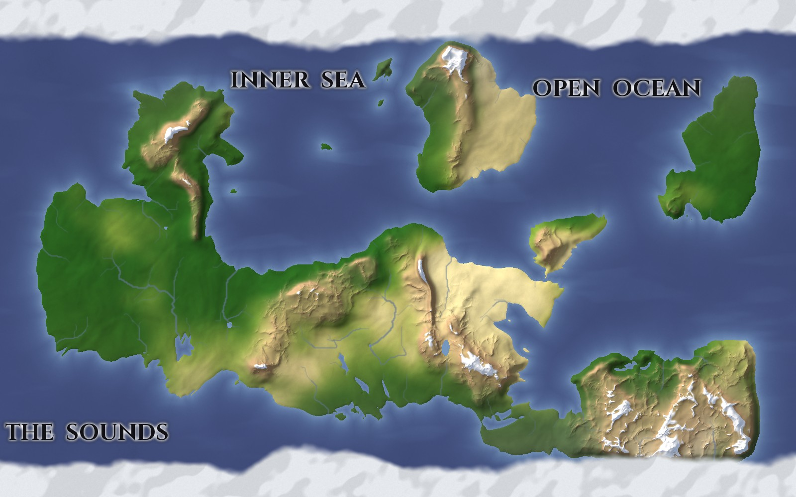

# Spike: "Painted Relief" style

A throwaway look-development prototype. It checks that our target world-map look (reference map #2: painted biome colours, shaded relief, snowy ridges, a pale coastal shelf, polar ice, serif labels with a glow) can be made **entirely from data**, with no hand painting and no AI image generation.



*Random archipelago, seed 42: a style test, not anyone's map.*

## The pipeline (each step becomes a real engine module later)

1. **Landmass:** domain-warped fBm noise plus elliptical "island cores". Sea level is set by a target land fraction.
2. **Mountains:** ridged noise along a spine on each island, plus highland belts.
3. **Erosion and hydrology:** priority-flood depression filling, D8 flow, flow accumulation, stream-power erosion, then rivers and lakes.
4. **Climate:** latitude and elevation give temperature. Noise, coast distance and a westerly rain shadow give moisture.
5. **Colour passes:** a temperature × moisture palette (soft, painted edges), then rock on steep and high ground, then snow on high ridges, then multi-directional hillshade (snow shadows go cool blue).
6. **Water:** deep slate blue, then a light shelf glow near the coast, then the shallow rim. Lakes and rivers are drawn on top.
7. **Polar ice:** puffy, cloud-like white bands.
8. **Labels:** placed in the largest open-water areas, Cinzel caps with a white glow.

## Gaps vs. the reference (to fix in the real engine)

- Mountain detail is softer. Real GPU hydraulic erosion at full resolution will give the crisp gullies and ridges.
- Rivers follow 8-direction steps. The real version smooths them into meanders.
- Labels are straight. The real version bends them along curves and sizes them by importance.
- Ice shading is still a little blotchy.

## Sketch to map: `from_reference.py`

This turns a flat landmass sketch into a Painted Relief map. It's the prototype of the plan's reference-to-map pipeline (PLAN §6). The sketch should have:
- olive land on blue-grey water
- **red strokes** for mountain ranges
- a **green dot** for a city

The script smooths the hex-stepped coasts, builds height from distance to the coast plus a rugged belt along the red strokes, erodes the terrain, works out rivers, and renders it with `render.py`'s passes.

```bash
python3 from_reference.py my-sketch.jpg \
  --region "THE LOWLANDS,1745,1790" --font path/to/Cinzel.ttf --out render.jpg
```

A render takes about 50 seconds at 2048².

## Pass 2: the anti-plastic renderer (`render_textured.py`)

The first reader's verdict on pass 1 was "a little plasticky". A side-by-side with the reference showed why: smooth whole-island shading and no detail below about 10 px. Pass 2 fixes this:
- **Shading from local relief** (high-passed height), not whole-island lighting
- **Erosion-style fBm** (higher octaves damped by accumulated slope), giving gullies and spurs, plus crisp ridged crests
- **Lowland micro-relief**, **canopy speckle**, **forest clumps** and **hue drift**
- **Valley occlusion**, **broken snow**, and **rivers traced into smoothed, meandering polylines**
- A thin **coast edge**, grain, and an unsharp mask

`from_reference.py` uses it by default (`--style smooth` gives the pass-1 look). Range controls:
- `--mtn-width` and `--mtn-height`: red strokes are skeletonised to centrelines, so the drawn thickness doesn't matter
- `--coast-smooth`: melts hex-grid stair-steps
- `--min-lake`: drops noise-hollow lakes
- `--cache sim.npz`: skips re-simulating when only the look changes
- `--spurs`: density of inland spur ridges (0 = none); `--keep-clear`: spur-free radius around the city
- `--lat-top`, `--lat-bot`, `--moist-lat`, `--snow-lat`: the climate gradient
- `--climate-region 'LABEL;cx;cy;r;temp;moist;snow;edge'`: a climate region that overrides the gradient (repeatable)
- `--mi-per-ref-px` or `--city-km`: scale, which adds an automatic scale bar

## Run it

Needs Python 3 with `numpy`, `scipy` and `pillow`. The Cinzel font (OFL licence) is optional and falls back to DejaVu Serif.

```bash
python3 render.py --seed 42 --out preview.png --font path/to/Cinzel.ttf
```

It takes about 20 seconds on 4 CPU cores at 1600×1000.
